<p align="center">
  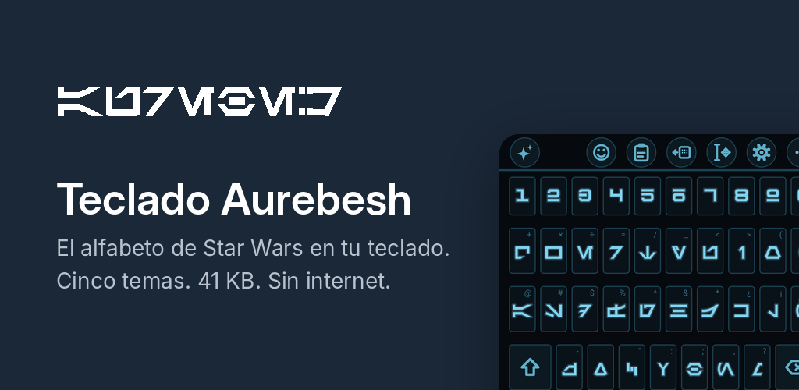
</p>

<h1 align="center">Teclado Aurebesh para Samsung One UI 9.0</h1>

<p align="center">
  <b>El alfabeto de Star Wars en tu teclado.</b> Las teclas muestran glifos Aurebesh; lo que escribes se envía en letras normales,
  así cualquiera puede leerlo. Con autocorrector, deslizar para escribir, emojis con búsqueda, portapapeles con imágenes,
  teclado dividido para Fold y un panel de inteligencia que funciona sin internet.
</p>

<p align="center">
  <a href="https://github.com/JonathanCruze/teclado-aurebesh-samsung-oneui9/raw/main/releases/TecladoAurebesh.apk">
    
  </a>
</p>

<p align="center">
  
  
  
  
  
  
  
</p>

> **Compatibilidad.** Optimizado y probado en **Samsung Galaxy con One UI 9.0 (Android 17)**. Cualquier otra versión de
> Android u otro fabricante es **experimental y está sujeta a fallos**: la app lo detecta y muestra un aviso.
> Página del proyecto: [docs/index.html](docs/index.html) · Versiones: [Releases](https://github.com/JonathanCruze/teclado-aurebesh-samsung-oneui9/releases)

---

## Instalar en tres pasos (sin saber qué es GitHub)

1. **Descarga el APK** desde el teléfono con el botón grande de arriba. Si el navegador pregunta, elige *Descargar de todas formas*:
   es un archivo de ~1,5 MB firmado por este proyecto.
2. **Abre el archivo** desde la barra de notificaciones o desde *Mis archivos › Descargas*. Si Android dice que no permite instalar
   apps desconocidas, toca **Ajustes** en ese aviso y activa *Permitir de esta fuente* para el navegador; vuelve atrás y toca **Instalar**.
3. **Abre Teclado Aurebesh**: arriba del todo están los tres idiomas (cambian la app y el teclado a la vez) y el botón
   **Activar el teclado** / **Elegir teclado**; debajo dice en qué paso vas. Para volver al teclado de Samsung en cualquier
   momento, mantén pulsada la barra espaciadora.

Para actualizar, descarga el nuevo APK e instálalo encima: conserva tus ajustes.

### Novedades de la 2.2
- **Ajustes reorganizados al estilo One UI:** pantalla principal con idiomas, buscador, "Pruébalo" y una lista de categorías con
  su resumen (Idiomas y teclas, Estilo, Tamaño y distribución, Escritura inteligente, Deslizar, tocar y respuesta, Portapapeles,
  Inteligencia, Privacidad y datos, Ayuda y gestos); cada una abre su propia página y el buscador lleva a la fila exacta.
- **Ajuste de tamaño sin rebotes:** al arrastrar el tirador se ve una vista previa del borde y el porcentaje; el alto se aplica
  una sola vez al soltar. Antes cada cambio movía la ventana del teclado y el arrastre se medía contra una posición desfasada.
- **Dos automáticos:** República (Estelar de día, Noche de noche) e Imperio (Arena de día, Imperial de noche), destacados en un
  grupo propio que deja claro que siguen el modo oscuro del teléfono.
- **Fila superior a elegir:** números, los ocho dígrafos Aurebesh en su lugar, o nada; los números siguen a una pulsación larga.
- **Teclado numérico completo:** paréntesis, operadores y separador en los campos numéricos; + * # ( ) - / y pausa en teléfono;
  el PIN sigue siendo solo dígitos.
- **Pistas latinas abajo al centro** y el glifo algo más alto en números y dígrafos, para que nunca se tapen.
- **Todo en Aurebesh** (antes "barra de traducción"): con la opción activa, también las sugerencias y la corrección se muestran
  en glifos.
- **Glifos nuevos:** la barra invertida y ± £ ¥ ° © ® ™ de la fuente original, ø, ≠ y ‰ compuestos a partir de o, = y %, y las
  vocales con acento grave, diéresis, circunflejo y tilde con marcas propias (la de la ñ, un 50 % más larga). La página 3/3 de
  acentos desaparece: los acentos viven en la pulsación larga de cada vocal, por idioma. × y ÷ esperan tu visto bueno a la previa.
- **Inteligencia:** Viñetas devuelve un título y un elemento por línea con "- "; Traducir responde solo con la traducción, limpia
  preámbulos y, si el modelo repite el original, reintenta una vez antes de avisar.
- **Sables:** bronce para Cal Kestis, Baylan Skoll y Shin Hati; amarillo para la Guardia del Templo y Rey; el rojo pasa a
  "Kyber corrompido". Reva lleva rojo de Inquisidor y Quinlan Vos verde, así que no cambian de color.

### Novedades de la 2.1
- **Teclas y márgenes como Samsung Keyboard**, medidos en un Galaxy Z Flip 7 y un Z Fold 7: margen lateral del 2,1 % (5 % en
  plegables desplegados), paso de columna de 40 dp con cara de 34 dp, filas de 64 dp con la cara 7,25 dp más corta por arriba y
  por abajo (49,5 dp), fila de números de 56 dp con teclas normales, y en pantallas anchas el aire entre teclas crece con ellas
  (caras casi cuadradas en el Fold). Las celdas de toque siguen siendo enteras: el aire también responde.
- **Pistas latinas abajo a la derecha** de la tecla, lejos de la alternativa de mantener, que sigue arriba a la derecha.
- **Caracteres alternativos**, como la opción homónima de Samsung: cada letra insinúa su símbolo arriba a la derecha (q +, w ×,
  a @, s #, k ¿, m ?) y lo escribe al mantenerla; los acentos siguen en el mismo menú. Se apaga en Diseño.
- **Glifos con la misma escala:** la i, la l y la m ya no salen más altas que la w cuando las teclas son estrechas o altas; todo el
  alfabeto comparte la escala, como una fuente.
- **Alternativas por idioma:** en español ya no aparecen ß ni ç al mantener la s o la c; en alemán la ß sigue en la s y las teclas
  ü, ö y ä muestran el glifo de su base con la letra completa debajo.
- **Apaisado arreglado:** el teclado se cortaba porque el contexto con el idioma de la app conservaba la configuración vertical
  tras girar; ahora se envuelve de nuevo en cada giro, la vista mide la pantalla real y nunca pasa del 56 % del alto. En
  teléfonos apaisados se usa el editor a pantalla completa, como Samsung.
- **PIN numérico** en lugar de contraseña en los campos de prueba de la app: enseña el teclado numérico y se trata como campo
  privado (sin vista previa, sin aprendizaje, sin inteligencia).
- **Pruebas:** GeometriaTest y AltCharsTest nuevas (Flip apaisado, métricas Samsung, pistas, glifos uniformes, alternativas,
  caracteres alternativos, umlauts, fila de números, aire en el Fold), 141 pruebas en total. Capturas en `screenshots/`:
  `geometria_samsung.png`, `caracteres_alternativos.png`, `pistas_abajo_derecha.png`, `qwertz_umlauts.png`,
  `tamano_flip_apaisado.png`, `aire_fold_dividido.png`.

### Novedades de la 2.0.1
- **Deslizar reconoce el léxico Star Wars:** con el diccionario Star Wars activo, trazar *coruscant*, *palpatine* o *kyber*
  escribe Coruscant, Palpatine y kyber (antes salían *croissant*, *perdonarme* y *klinger*). Las palabras de tu diccionario
  personal ya se reconocían; ahora las dos listas pasan por el mismo camino.
- **Deslizado más fiel a la forma:** la puntuación incluye la mayor desviación entre el trazo y la palabra, no solo la media,
  así una palabra frecuente ya no le gana a la que de verdad trazaste (*tenido* tapaba a un *teclado* perfecto). En la prueba de
  60 palabras corrientes con tres grados de desvío acierta 177 de 180 a la primera; los tres restantes son *perro* sin pausa en
  la doble erre, que sale como *pero* y ofrece *perro* en la barra.
- **Pruebas rápidas de deslizar** (`GlideQuickTest`): palabras corrientes y del léxico con ruido de sensor y reloj reales, estela en
  los seis colores en tema claro y oscuro, desvanecimiento medido en píxeles (cero rastro pasados 600 ms) y una variante con dedo
  tembloroso. Capturas en `screenshots/deslizar_*.png`.

### Novedades de la 2.0
- **Estela de sable de luz** al deslizar para escribir: curva continua con núcleo blanco, hoja de color y halo, que se desvanece
  por la cola; seis colores en Diseño: Azul (Anakin y Obi-Wan), Verde (Luke y Qui-Gon), Amarillo (Guardia del Templo), Bronce,
  Morado (Mace Windu) y Rojo (Sith).
- **Sugerencias con fondo:** una sola banda redondeada con separadores finos para todas las palabras, y solo la autocorrección
  pendiente lleva su propia pastilla de acento. Se eligió un único fondo, como Samsung Keyboard y Gboard, porque una pastilla por
  palabra añade ruido visual y reduce el área de toque; las celdas se reparten el ancho a partes iguales.
- **Cinta personalizable y "…":** el último icono abre una cuadrícula con todas las herramientas (emojis, portapapeles, una mano,
  edición de texto, traducir, dividir, barra de traducción, idioma, tamaño, ocultar, ajustes); con "Editar" eliges cuáles van en
  la cinta y en qué orden.
- **Panel de edición de texto** como el de Samsung: cruceta con repetición, Seleccionar, Seleccionar todo, Cortar, Copiar, Pegar,
  Deshacer, Rehacer, Inicio y Fin.
- **Portapapeles con elementos fijados:** mantén pulsado un elemento para fijarlo; los fijados van arriba, sobreviven a "Borrar
  todo" y al reinicio del teléfono (se guardan en el almacenamiento privado de la app).
- **Diccionario Star Wars** (activable en Escritura inteligente): más de 450 nombres de personajes, naves, planetas, especies y
  términos (Coruscant, Ahsoka, Venator, Palpatine, Holocrón, Kyber…) que se completan y se corrigen con sus mayúsculas
  ("curuscant" → "Coruscant", "palatino" → "Palpatine") en los tres idiomas; las palabras normales no cambian.
- **Diccionario personal:** añade tus propias palabras (nombres, apodos, términos de trabajo) y expórtalas o impórtalas como
  texto; además el teclado aprende solo una palabra nueva que escribes dos veces y una corrección que deshaces dos veces, y
  corrige hacia todas ellas. Todo queda en el teléfono.
- **Inteligencia más rápida en el teléfono:** la parte fija del prompt se evalúa una sola vez y se reutiliza (caché de prefijo),
  hasta seis hilos, progreso real mientras lee el texto con posibilidad de cancelar, errores con la acción que los resuelve,
  historial de hasta cinco resultados y tonos personalizados guardados. Nota honesta: Galaxy AI corre en el NPU con modelos y
  API privados de Samsung que un teclado de terceros no puede usar; aquí el motor es Java puro, así que para velocidad real la
  opción es un servidor propio.
- **Emojis con tono de piel** al mantener pulsado un emoji de manos o personas; se recuerda el último tono por emoji.
- **Letras latinas "Aprendiendo":** cada letra muestra su pista hasta unas 40 pulsaciones y luego desaparece; se puede
  reiniciar el progreso.
- **Accesibilidad:** nodos de accesibilidad por tecla, sugerencia e icono para TalkBack, exploración táctil, tema de alto
  contraste y controles de Ajustes con rol y estado.
- **Ajustes:** buscador de ajustes, Restablecer ajustes, Borrar datos personales, tarjeta "Datos en este teléfono" con tamaños
  y borrado, exportar e importar ajustes como JSON.
- **Pantalla de cubierta del Z Flip:** no es un fallo del teclado. One UI reserva la pantalla exterior para Samsung Keyboard y no
  permite teclados de terceros ahí (tampoco Gboard); no existe ninguna declaración en el manifiesto que lo habilite.

### Novedades de la 1.10
- **Toques que no escriben lo que no querías.** El menú de alternativas incluye la letra base, cabe en dos filas y se cancela al
  alejar el dedo; mantener `.` o `,` da toda la puntuación (`? ¿ ! ¡ : ; - " ' @`); soltar fuera del teclado no escribe; mantener
  Shift con un pulgar y teclear con el otro escribe en mayúsculas, y deslizar desde Shift a una letra la escribe en mayúscula.
- **Autocorrección honesta.** Las predicciones al inicio de frase van en mayúscula; tras corregir, la barra muestra la palabra
  original para recuperarla con un toque; el retroceso deshace la corrección sin aprender el error.
- **Deslizar sobre la barra espaciadora** mueve el cursor (con Shift, selecciona) o cambia de idioma como en One UI; se elige en
  Escritura inteligente. **Mantener borrar** acelera y, pasados dos segundos, borra palabras enteras.
- **El teclado se adapta al campo sin dejar el Aurebesh:** numérico 3×4 con glifos grandes en número, teléfono y PIN (con `+ * #`
  y pausa en teléfono, decimal y signo según el campo); `@` y `.com` en correo; `/` y `.com` en direcciones web.
- **Tamaño y posición como "Tamaño y transparencia" de Samsung:** alto continuo del 70 al 140 % con deslizador, margen inferior
  con botón ∨ para ocultar el teclado, modo de ajuste con tiradores desde el icono de tamaño en ?123, filas compactas en la tapa
  del Z Flip, tope de ancho de tecla en tabletas y DeX, ancho de las mitades del dividido; una mano con máximo de 400 dp y ajustes
  guardados aparte para la tapa y la pantalla interior de un Fold.
- **Escritura inteligente que aprende de ti:** atajos de texto (`tqm` → `te quiero mucho`) gestionados en Ajustes, palabras
  nuevas que repites se aprenden solas y el corrector también corrige hacia ellas, diccionario personal visible y editable,
  emojis para las palabras cotidianas (`hola` 👋, `jajaja` 😂) también tras el espacio.
- **Ajustes como One UI:** Pruébalo, Diseño, Tamaño y posición, Escritura inteligente, Tocar y respuesta, Portapapeles,
  Inteligencia y Ayuda y gestos (Plegables · Galaxy Z Fold solo en pantallas anchas); texto predictivo, sustitución automática y
  mayúsculas automáticas por separado; burbuja opcional; tema Automático que sigue el modo oscuro; retardo de pulsación larga,
  intensidad de vibración y volumen del clic; columna centrada en el Fold.
- **Panel ✦:** acción Traducir (español, inglés, alemán u otro idioma) y el modelo ya no se descarga al plegar o girar: un solo
  motor vive en el servicio y una generación en curso sigue en el panel nuevo.
- **Letras con acento a la vista:** mantener una vocal da todas sus variantes (á à â ä ã å æ, ó ò ô ö õ ø œ…), `c` da `ç`,
  `s` da `ß`, `y` da `ý ÿ`; además la página 3/3 de ?123 muestra todas las letras con acento como teclas, con el glifo de la
  letra base y la letra latina siempre visible. En el menú de alternativas las letras con acento ya se dibujan con su glifo.
- **Modelo más ligero para la IA:** SmolLM2 135M (145 MB, Apache-2.0), unas tres veces más rápido que Qwen2.5 0.5B, con
  español básico; y el motor usa hasta seis hilos en vez de cuatro. En un Z Flip 7 sigue siendo lento comparado con un
  servidor propio.
- **Bajo el capó:** vibración coherente en todas las bandejas, el teclado solo reacciona a las preferencias que le afectan,
  corrección sin bloquear el hilo principal, portapapeles y bigramas en archivos propios con escritura diferida.

### Novedades de la 1.9.2
- **Margen lateral en las teclas**, como en Samsung Keyboard: las teclas empiezan a un 3 % del ancho en teléfonos y a un 5 % en
  pantallas de 600 dp o más (Fold desplegado), nunca menos de 8 dp, en el teclado normal, a una mano y dividido; la cinta de
  herramientas (✦, sugerencias, emojis, portapapeles) sigue de borde a borde. Tocar dentro del margen pulsa la tecla del borde. En
  el dividido las mitades miden el 37,5 % del ancho y el hueco central el 15 %, como en Samsung.

### Novedades de la 1.9.1
- **Arreglado: "Este archivo no es un modelo GGUF admitido"** al usar un modelo descargado. El tokenizador compilaba sus expresiones
  regulares con una bandera de Java que Android no admite (`UNICODE_CHARACTER_CLASS`); funcionaba en las pruebas de escritorio y
  fallaba en el teléfono. Ahora las clases de espacios se escriben explícitamente y la prueba del tokenizador comprueba que no se
  use ninguna bandera ajena a Android. Si algo vuelve a fallar, el panel ✦ muestra el motivo concreto en vez del mensaje genérico.
- **Botón Probar** junto a cada modelo instalado: carga el modelo, escribe una frase y muestra tokens/s y el tiempo de carga (o el error).
- **Ajustes › Inteligencia más claro**: "Dónde se ejecuta la IA" con dos opciones explicadas (en este teléfono / tu propio servidor),
  el único paso necesario ("Toca Descargar junto a un modelo"), la recomendación para tu teléfono (familia Galaxy y RAM detectadas)
  y una guía de qué modelo elegir según el Galaxy.
- **Arriba de la app**: los tres idiomas (Español, English, Deutsch) como iconos que cambian a la vez el idioma de la app y del
  teclado, y el botón para activar o elegir el teclado con el estado debajo.
- **Ajustes con secciones colapsables**: Pruébalo, Apariencia, Escritura, Plegables, Inteligencia y Gestos son tarjetas que se
  abren y cierran (se recuerda cuáles), con un resumen de una línea de sus valores actuales (tema, tamaño, modelo listo…) y una
  fila "Ir a" arriba que abre la sección y la lleva a la vista; desde el engrane del teclado se abre directamente Inteligencia.
- **Sección Plegables**: el teclado dividido tiene su propio apartado con explicación (en un teléfono normal o un Z Flip no cambia
  nada) y la detección de la pantalla actual; sigue pudiendo desactivarse ("Nunca"), como en Samsung Keyboard.
- **Teclado dividido con la geometría de Samsung Keyboard** en el Fold desplegado: dos cajas de 5,5 teclas pegadas a los bordes,
  fila central corrida media tecla hacia el hueco, z-v bajo s-f y b-m bajo j-l, mayúsculas y borrar de 1,5 teclas en los bordes,
  `?123 , espacio | espacio . intro`.

---

## Qué hace

<table>
  <tr>
    <td width="33%" align="center">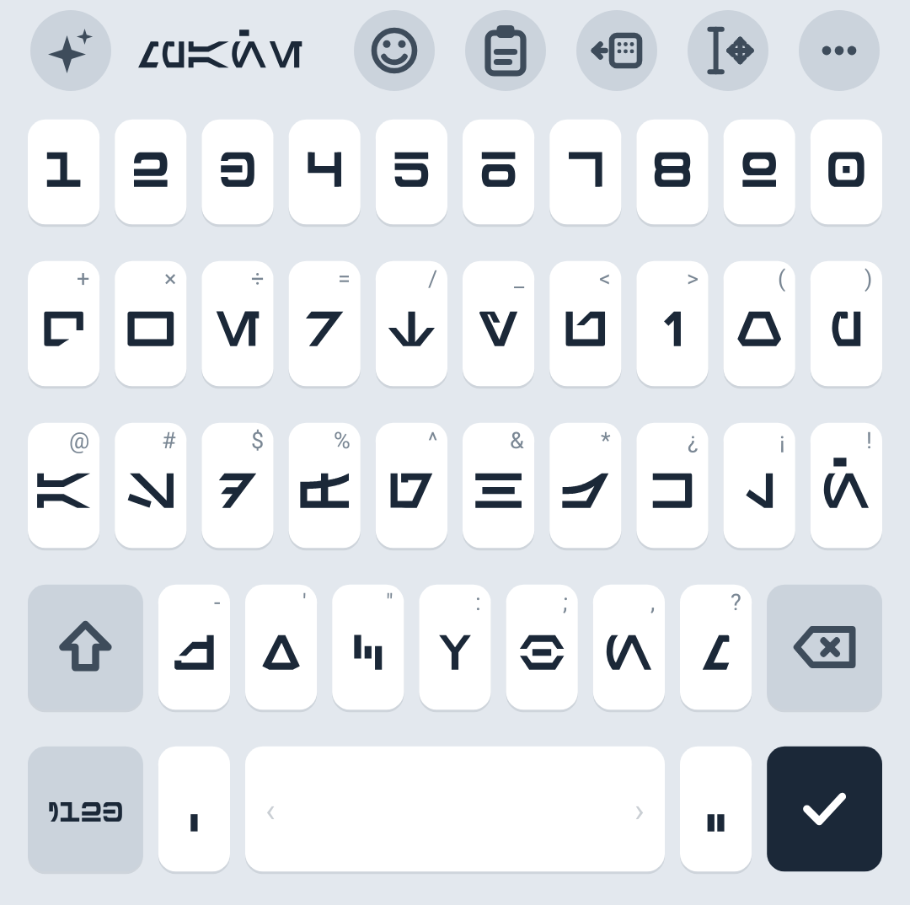<br><b>Barra como la de Samsung</b><br>✦ inteligencia a la izquierda; 😊 emojis, 📋 portapapeles y modo a una mano a la derecha; ⚙ ajustes en ?123.</td>
    <td width="33%" align="center">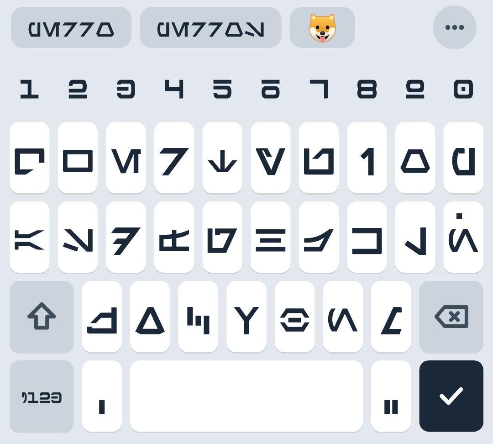<br><b>Autocorrector con emojis</b><br>Corrige uno o dos errores, restaura tildes, completa palabras y sugiere el emoji de lo que escribes.</td>
    <td width="33%" align="center">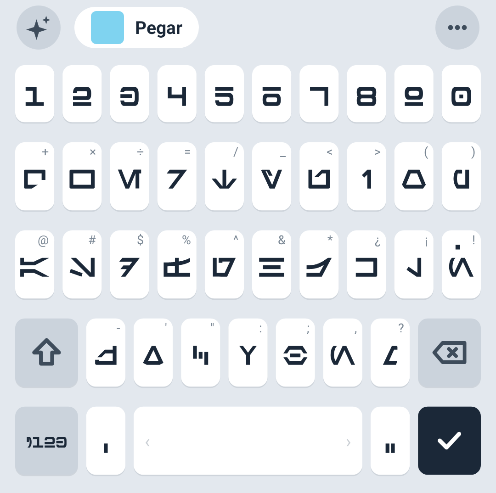<br><b>Chip "Pegar"</b><br>Lo que acabas de copiar (texto, imagen o captura) aparece listo para pegar y desaparece al escribir.</td>
  </tr>
  <tr>
    <td align="center">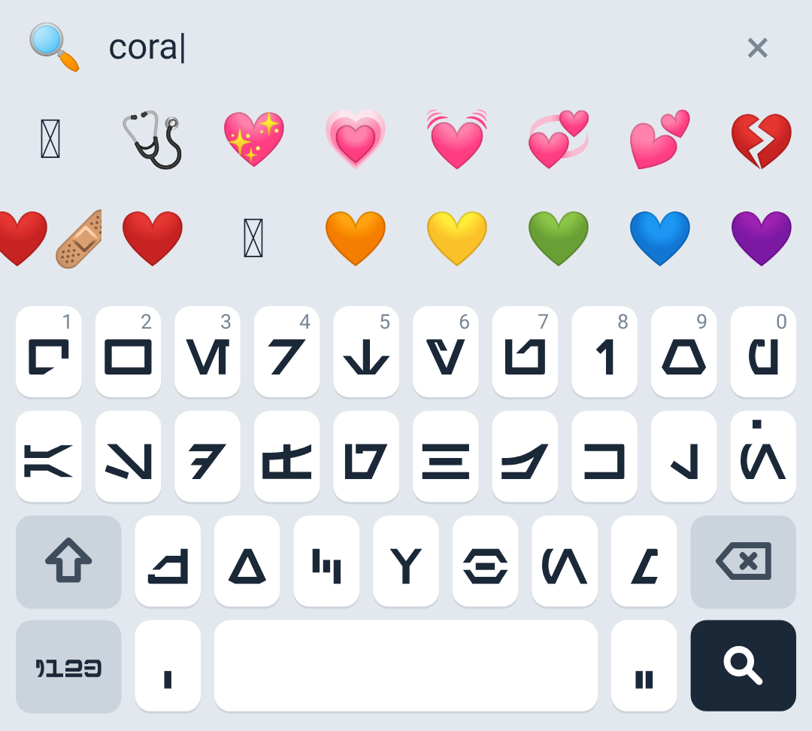<br><b>Emojis con búsqueda</b><br>Grupos y subgrupos oficiales de Unicode, recientes y búsqueda tolerante a errores en español e inglés.</td>
    <td align="center">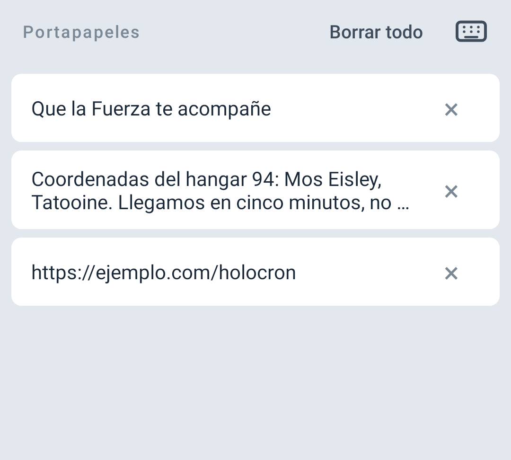<br><b>Portapapeles con imágenes</b><br>Historial de texto e imágenes; "solo el número", "solo el correo" o "solo el enlace" con un toque.</td>
    <td align="center">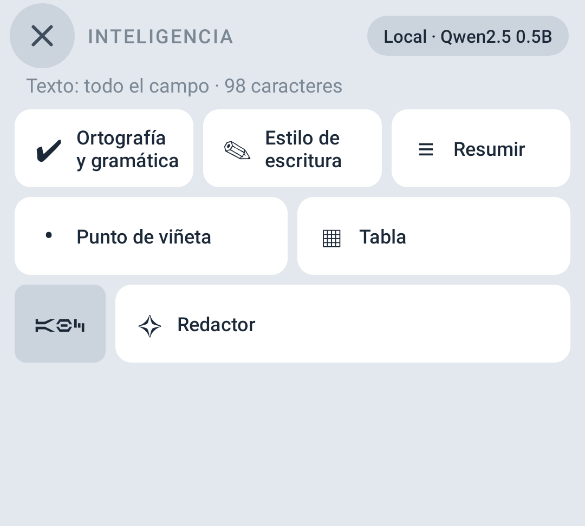<br><b>✦ Inteligencia</b><br>Ortografía, estilo con tonos, resumir, viñetas, tabla y redactor, con un modelo en tu teléfono o tu propio servidor.</td>
  </tr>
  <tr>
    <td align="center">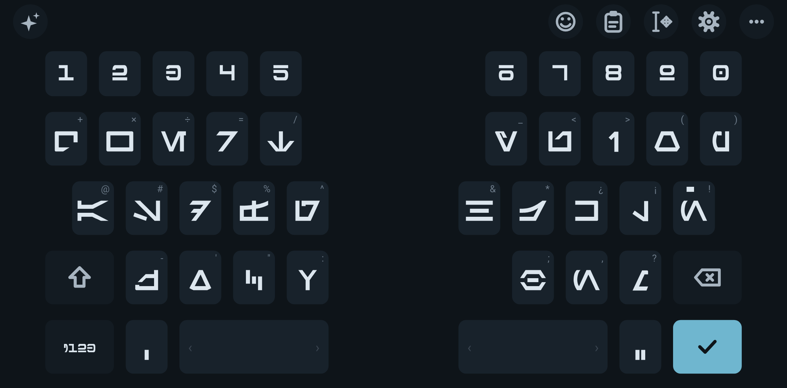<br><b>Dividido para Galaxy Fold</b><br>Al desplegar, dos mitades con la misma geometría que Samsung Keyboard (filas escalonadas, dos espacios); se puede desactivar.</td>
    <td align="center">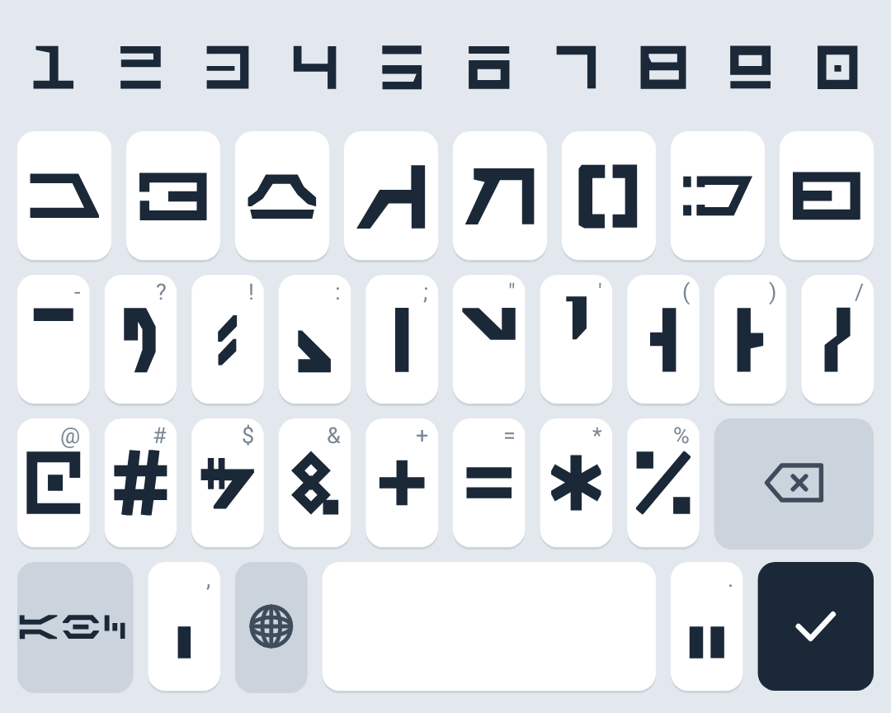<br><b>?123 como Samsung Keyboard</b><br>Misma distribución de signos; la página 2/3 añade dígrafos Aurebesh, ¿ ¡ « » y más símbolos, y la 3/3 todas las letras con acento (à â ä ç ö ô ü ß…).</td>
    <td align="center">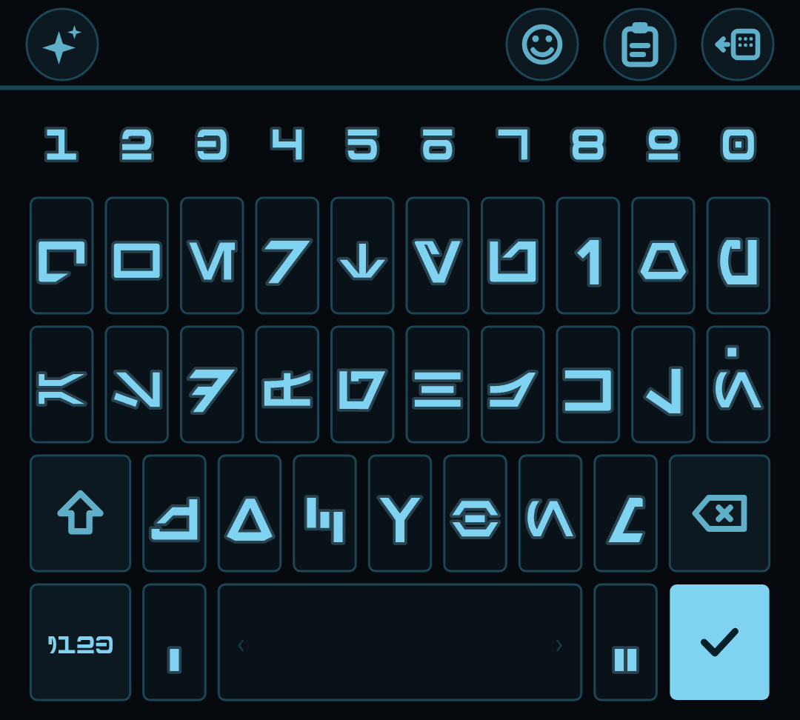<br><b>Cinco temas</b><br>Estelar, Noche, Datapad, Imperial y Arena; la app sigue el modo claro u oscuro del teléfono.</td>
  </tr>
</table>

- **Deslizar para escribir**: traza la palabra sobre las letras (estela de sable del color elegido) y aparece con sus alternativas;
  retroceso justo después la borra entera. Decodificador propio al estilo SHARK2; en trayectorias sintéticas con desvío realista acierta
  a la primera el 98 % en español y el 97 % en inglés.
- **Predicción de la siguiente palabra** con tablas de bigramas de corpus abiertos y los pares que tú mismo escribes (aprendidos
  solo en el teléfono).
- **Tres idiomas de teclado**: español (ñ, ¿ ¡), inglés y alemán (QWERTZ con ü ö ä y ß en pulsación larga), cada uno con su
  diccionario y sus bigramas. El globo alterna entre los activos.
- **Idioma de la app y del teclado**: Español, English o Deutsch desde los iconos de arriba de la app; cambian los menús y la
  distribución del teclado a la vez (el globo sigue rotando entre los idiomas activados).
- **Modo a una mano** (con flecha para cambiar de lado), **sonido de tecla personalizado**, **tamaño del teclado** en cuatro
  niveles, letra latina opcional en las teclas para aprender el alfabeto, barra de traducción, punto con doble espacio.
- Burbuja al pulsar con el glifo grande y la letra latina; `¿` y `¡` tienen glifo propio (el de `?` y `!` girado 180°).

## ✦ Inteligencia

El panel ✦ (a la izquierda de la barra, donde salen las sugerencias) ofrece **Ortografía y gramática**, **Estilo de escritura**
(original corregido, formal, respetuoso, amigable o un tono que tú describes), **Resumir**, **Viñetas**, **Tabla** y **Redactor**
a partir de un prompt. El resultado se puede reemplazar, insertar, copiar o reintentar.

<p align="center">
  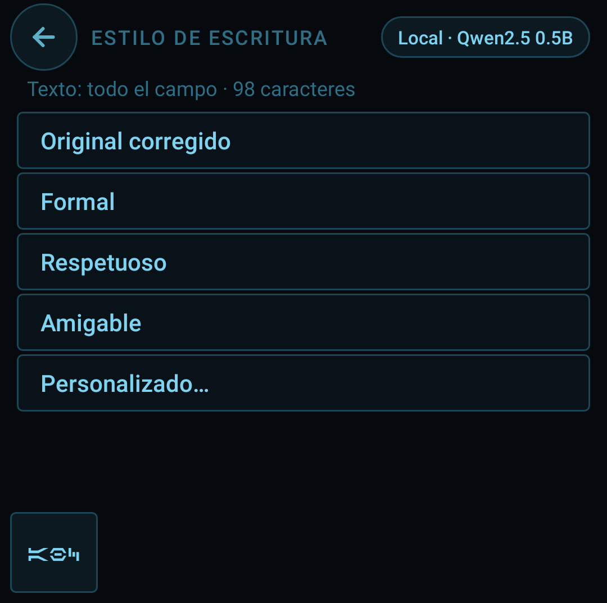 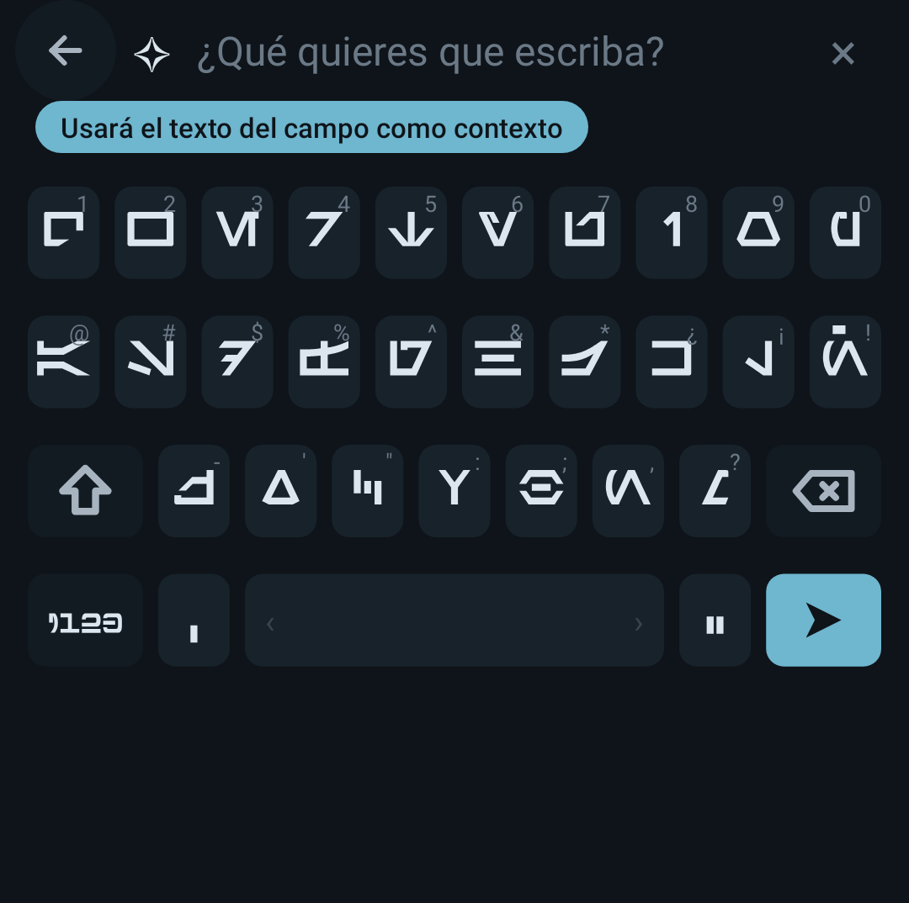
</p>

- **Modelo en el teléfono.** Un motor de inferencia GGUF escrito en Java puro (sin librerías, sin NDK) ejecuta un modelo pequeño de
  pesos abiertos. Por defecto **Qwen2.5-0.5B-Instruct Q4_0 (≈352 MB)**; alternativas Qwen2.5-0.5B Q8_0 (≈531 MB), Qwen3-0.6B Q8_0
  (≈639 MB) y SmolLM2-360M-Instruct Q8_0 (≈386 MB, solo inglés). Todos con licencia Apache-2.0. El modelo se descarga de Hugging Face
  **solo cuando tocas Descargar** en Ajustes › Inteligencia, o se importa un archivo `.gguf` que ya tengas.
- **Servidor propio (opcional).** Si prefieres velocidad, indica un servidor compatible con la API de OpenAI (Ollama, LM Studio o
  llama.cpp en tu ordenador). Solo recibe el texto que eliges procesar.
- **Velocidad, con honestidad.** En un teléfono el modelo local genera unos pocos tokens por segundo: reescribir un párrafo puede
  tardar entre 20 y 60 segundos; el texto va apareciendo y se puede cancelar.
- **Qué modelo para qué Galaxy.** La app detecta la familia Galaxy y la RAM y recomienda un modelo; como guía: con 12 GB o más
  (Galaxy S26 Ultra, S26+, S26, S25 Ultra, S25+, S25, Z Fold 8/7/6, Z Flip 8/7/6) cualquiera de la lista, Q8_0 o Qwen3 0.6B si
  prefieres calidad; con 8 GB (S24, S23, A56, A55) Qwen2.5 0.5B Q4_0; con 6 GB o menos (A3x, A2x, A1x) Q4_0 va lento, SmolLM2 360M
  (solo inglés) o un servidor propio.
- **Botón Probar.** Junto a cada modelo instalado: carga el modelo, escribe una frase y muestra tokens/s y el tiempo de carga, o el
  motivo exacto del fallo.
- **Estado de verificación.** El motor se comprobó numéricamente en el entorno de desarrollo contra una implementación de referencia
  (numpy) y con los vocabularios reales de llama.cpp, incluidos los formatos Q4_0, Q8_0, Q4_K y Q6_K. En la 1.9 la primera prueba
  en un Galaxy real falló al cargar el modelo por una bandera de expresiones regulares que Android no admite; está corregido en la
  1.10 y la prueba del tokenizador lo vigila. Sigue sin haberse medido la velocidad con un modelo real en un teléfono: trátalo como
  experimental.
- Galaxy AI (el de Samsung Keyboard) es exclusivo de Samsung y no se puede integrar; sigue disponible en el menú de selección de texto
  de Android mientras usas este teclado.

## Frente a Samsung Keyboard

| Función | Samsung Keyboard | Teclado Aurebesh 2.0 |
|---|---|---|
| Galaxy AI / Inteligencia avanzada | Sí | Inteligencia local (modelo en el teléfono) o servidor propio |
| Deslizar para escribir | Sí | Sí, con estela y alternativas |
| Emojis | Sí | Sí, con búsqueda y sugerencias en la barra |
| Portapapeles con historial | Sí | Sí, texto e imágenes, "solo el número/correo/enlace" |
| Capturas de pantalla sugeridas | Sí | Sí (permiso de fotos opcional) |
| Modo a una mano | Sí | Sí |
| Teclado dividido (Fold) | Sí | Sí |
| Teclado flotante | Sí | No |
| Dictado por voz | Sí | No |
| Alfabeto Aurebesh | No | Sí |

## Privacidad

- **Sin recopilación de datos.** No hay analítica, ni registros, ni cuentas.
- **Internet** solo para dos cosas que tú inicias: descargar un modelo de inteligencia o hablar con tu propio servidor. A ese servidor
  se envía únicamente la selección o el texto del campo que decides procesar (hasta 8000 caracteres) y la app lo avisa la primera vez.
- **Permiso de fotos (opcional)**, solo si activas "Sugerir capturas": lee únicamente la carpeta *Screenshots* y copia la captura
  reciente a la carpeta privada de la app.
- **Lo que se guarda, siempre en el teléfono y borrable desde Ajustes:** el historial del portapapeles (hasta 20 elementos),
  las palabras que conservas (hasta 500), los pares de palabras aprendidos (hasta 2000), los modelos que descargas y el sonido
  personalizado. La copia de seguridad de Android está desactivada para esta app.
- No corrige ni aprende en contraseñas, correos, URL ni campos marcados sin sugerencias.

## Autocorrección y predicción

Los teléfonos Samsung suelen venir sin corrector ortográfico del sistema para teclados de terceros, así que el teclado lleva el suyo:

- Diccionarios de 40 000 palabras por idioma (`app/src/main/res/raw/words_es.txt`, `words_en.txt`, `words_de.txt`), generados por
  `tools/build_dictionaries.py` a partir de las listas de frecuencia de FrequencyWords (MIT).
- Palabra desconocida → mejor candidato a **una o dos ediciones**, con el coste de cada error: cambiar una letra por una vecina en el
  teclado o por otra de sonido parecido (s/z, c/s, b/v…) cuesta poco, una sustitución arbitraria mucho; "fuersa" → "fuerza",
  "nesecito" → "necesito". **Restauración de tildes** ("mas" → "más", "cancion" → "canción"); las parejas ambiguas (esta/está) se respetan.
- **Completado**, también difuso ("qier" → "quiero"); en inglés "i" → "I" y contracciones ("dont" → "don't").
- **Contexto y siguiente palabra** con tablas de bigramas (`bigrams_es.txt`, `bigrams_en.txt`, `bigrams_de.txt`) construidas por
  `tools/build_bigrams.py` a partir de corpus abiertos: Common Voice (CC0 y extractos de Wikipedia CC BY-SA), Universal Dependencies,
  Europarl, SQuAD-es, Brown y webtext. Los pares que tú escribes se aprenden en el teléfono y tienen prioridad.
- La corrección se aplica al teclear espacio o puntuación; **retroceso la deshace** y el chip entre comillas conserva lo escrito
  (y lo aprende). Las sugerencias se calculan en segundo plano.

## Estructura
```
app/src/main/java/com/aurebesh/teclado/
  AurebeshIME.java           servicio de teclado: integra todo lo demás
  AurebeshKeyboardView.java  vista: distribuciones (es/en/de, ?123 1/3, 2/3 y 3/3 (acentos), dividido, una mano), barra, deslizar, dibujo, toque
  SwipeDecoder.java          decodificador de trazos (índice por primera/última letra, forma y posición)
  Dictionary.java            diccionarios y autocorrección (ediciones, tildes, completado, palabras aprendidas)
  Bigrams.java               siguiente palabra y contexto (tablas + pares aprendidos)
  EmojiSuggest.java          emoji sugerido por palabra (palabras clave de CLDR)
  EmojiTray.java             panel de emojis por grupos y subgrupos, recientes y búsqueda
  KeyboardTray.java          bandeja del portapapeles (texto, imágenes, chips de número/correo/enlace)
  ClipHistory.java           historial del portapapeles y extracción de teléfono/correo/enlace
  ClipProvider.java          ContentProvider que entrega las imágenes copiadas a la app destino
  ScreenshotWatcher.java     capturas de pantalla recientes (permiso de fotos opcional)
  ScreenshotSettingsRow.java fila de ajustes que pide el permiso
  AiTray.java                panel ✦ Inteligencia (acciones, tonos, redactor, resultado)
  AiRunner.java              construye los prompts y ejecuta en el modelo local o en el servidor
  AiModels.java              modelos: presets, descarga, importación, selección
  AiRemote.java              cliente de servidores compatibles con OpenAI (streaming)
  AiSettingsCard.java        tarjeta de ajustes de inteligencia
  llm/                       motor GGUF en Java puro: Gguf, Quant, Model, Tokenizer, ChatTemplate, Sampler, Workers, LlmEngine
  KeySound.java              clic de tecla: el del sistema o un audio elegido
  AppLocale.java             idioma de la app (sistema, es, en, de)
  Themes.java, ThemeSwatchView.java   temas y su muestra
  Glyphs.java, GlyphData.java         glifos Aurebesh (generados por tools/build_font_set.py)
  AurebeshTextView.java      texto renderizado en Aurebesh
  DeviceInfo.java            detección de Samsung / One UI
  MainActivity.java, Prefs.java        pantalla de ajustes y preferencias
app/src/main/res/raw/        words_*.txt, bigrams_*.txt, emoji.txt, emoji_names.txt
app/src/main/res/            strings (es/en/de), colores, tema, icono, method.xml (tres subtipos)
screenshot-test/             pruebas Robolectric: ScreenshotTest, SwipeTest, PredictionTest
tools/build_dictionaries.py  diccionarios desde FrequencyWords
tools/build_bigrams.py       tablas de bigramas desde los corpus abiertos
tools/build_emoji.py         emoji.txt y emoji_names.txt desde Unicode y CLDR
tools/build_font_set.py      glifos desde la fuente Aurebesh de SilvinoR
tools/llm/                   verificación del motor: modelos aleatorios + referencia numpy, tokenizador, kernels, benchmark
tools/dict/, tools/emoji/    licencias y procedencia de las listas y los emojis
promo/make_promo.py          imágenes promocionales a partir de las capturas reales (salida en promo/out/)
docs/index.html              página del proyecto (GitHub Pages)
releases/                    APK publicado
```

## Compilar
**Android Studio**: abre la carpeta (Gradle) y ejecuta.

**Sin Android Studio (Ubuntu/Debian)**:
```bash
sudo apt install aapt apksigner zipalign dalvik-exchange android-sdk-platform-23 openjdk-17-jdk
SDK_JAR=/ruta/a/android-28-o-superior.jar ./build.sh
```
`RES_JAR` (recursos, por defecto el `android.jar` 23 de Ubuntu) y `SDK_JAR` (compilación Java, necesita API 28 o superior) se
pueden sobrescribir; `KEYSTORE_PASS`, `VERSION_CODE` y `VERSION_NAME` también. El script genera un keystore propio la primera vez:
guárdalo para poder actualizar la app instalada. Todo es Java 8 sin librerías externas (se compila con `javac` y `dx`), minSdk 26.

Para regenerar los datos: `python3 tools/build_dictionaries.py`, `python3 tools/build_bigrams.py` y
`python3 tools/build_emoji.py` (ver la cabecera de cada script). Para verificar el motor de inteligencia:
`tools/llm/run_tests.sh` (necesita Python con `gguf`, `numpy` y `regex`).

## Idiomas
El teclado declara tres subtipos: **español**, **inglés** y **alemán**. Con más de uno activo aparece el globo, que alterna entre
ellos sin salir del teclado, y la barra espaciadora muestra el idioma actual. En español hay tecla ñ y mantener `,` da `¿`; en
inglés la fila tiene nueve teclas y mantener `,` da `!`; en alemán la distribución es QWERTZ con ü ö ä, ß en pulsación larga de la s
y mantener `,` da `;`. La autocorrección, la predicción y el deslizado usan el diccionario del idioma activo. Los menús están en
español, inglés y alemán; siguen el idioma del teléfono o el que elijas en Ajustes.

## Fuente
Los glifos salen de la fuente **Aurebesh de SilvinoR** (`font/base-silvinor-Aurebesh.ttf`, SIL Open Font License 1.1,
`font/OFL-silvinor.md`): letras, numerales, puntuación, signos y los ocho dígrafos como ligaduras. A ese conjunto se añaden la ñ con
cuadrado y las vocales con tilde. `tools/build_font_set.py` genera a partir de ello `GlyphData.java` (vectores con avance y margen de
cada glifo, que es lo que dibuja el teclado) y **`font/AurekTeclado.ttf`**, una fuente OpenType instalable con las mismas ligaduras,
también bajo OFL (con nombre propio, como exige la licencia por el nombre reservado "Aurebesh").

## Español: ñ y tildes
El Aurebesh canónico no tiene ñ ni acentos, y tampoco usa diacríticos: amplía el alfabeto con letras compuestas a partir de sus
propias piezas (barras, chevrones, cuadrados). Siguiendo ese criterio, la **ñ es *nern* con un cuadrado sobre el vértice** (el
cuadrado del dos puntos y de *shen*) y las vocales con tilde llevan una **barra corta a 45°** (el trazo de *senth* y *resh*), al
grosor de la fuente. Son diseño propio, no canon; otros diacríticos (ü, ö, ä, ç…) se muestran con el glifo base. El texto enviado
siempre lleva los caracteres correctos.

## Temas
| Tema | Construcción |
|---|---|
| Estelar | acero mate, teclas blancas con sombra, tinta azul noche como único acento |
| Noche | oscuro neutro, cian apagado solo en Enter y mayúsculas |
| Datapad | fondo casi negro, teclas solo trazadas, glifos azul luminoso con halo, esquinas de 3 dp |
| Imperial | grafito, glifos blancos, esquinas duras, un solo rojo apagado |
| Arena | tonos de arena, teclas hueso muy redondeadas, naranja de atardecer |

Añadir un tema es añadir una línea en `Themes.java`; el selector, la copia del teclado, las bandejas y las capturas lo recogen solos.

## Probar en un teléfono
Con el Samsung conectado por USB (depuración USB activada) y `adb` en el ordenador:
```bash
tools/device.sh install   # instala o actualiza el APK
tools/device.sh enable    # activa el teclado y lo deja como actual
tools/device.sh field     # abre un campo de texto real
tools/device.sh shot      # captura -> screenshots/device/captura.png
```
Desde una sesión de Claude Code en la nube, el teléfono se alcanza activando **Remote Control** en la app de escritorio de Claude
(Mac o Linux) sobre esta carpeta; en una sesión local basta con `adb`.

Sin teléfono a mano, `tools/testlab.sh` ejecuta la app en Galaxy reales de **Firebase Test Lab** (cuota gratuita diaria) y deja
capturas y vídeo en la consola de Firebase. Necesita `FIREBASE_PROJECT` y una clave de cuenta de servicio
(`GOOGLE_APPLICATION_CREDENTIALS` o `GOOGLE_APPLICATION_CREDENTIALS_JSON`).

## Probar (capturas reales sin emulador)
```bash
./build.sh                      # deja los recursos compilados en build/
cd screenshot-test && mvn test  # capturas en ../screenshots/
```
Diecisiete clases de prueba con Robolectric y gráficos nativos (126 pruebas). Las tres históricas:

- **ScreenshotTest** renderiza un teclado, una pantalla `?123` (y la 2/2), una barra y una burbuja por tema, la barra de sugerencias
  con emoji, el chip "Pegar", el modo a una mano, el teclado dividido (también a ancho de Fold), la bandeja del portapapeles con
  texto, chips e imagen, el panel de emojis y su búsqueda, los estados del panel ✦ Inteligencia, la app en claro, noche, inglés y en
  un dispositivo no probado, y el icono. Además comprueba que teclear "hola" produce "hola", que el diccionario corrige "holq" → "hola",
  "cancion" → "canción", "fuersa" → "fuerza", "nesecito" → "necesito" y "teh" → "the", que completa "qier" → "quiero", que respeta
  las palabras aprendidas, que la búsqueda de emojis encuentra "corazon", "mexico", "pizza" y "laugh" y que la extracción saca el
  teléfono, el correo y el enlace de un texto.
- **SwipeTest** genera trayectorias sintéticas por los centros de las teclas, con ruido, para las 200 palabras más frecuentes y exige
  al menos 80 % de acierto a la primera y 92 % entre las tres primeras (con desvío realista obtiene 98,5 % / 99,5 % en español y 97 % / 100 % en inglés; con trazos
  perfectos, 99 % / 100 % en ambos).
- **PredictionTest** comprueba la siguiente palabra ("muchas" → "gracias", "thank" → "you"), los pares aprendidos y el contexto.

Las demás cubren gestos, tamaño y posición, lógica del IME, escritura inteligente, ajustes, bandejas, traducción y velocidad de la
IA, estela de sable, accesibilidad, léxico Star Wars y las pruebas rápidas de deslizar (`GlideQuickTest`: palabras corrientes y del
léxico con ruido y reloj reales, estela en seis colores, desvanecimiento y dedo tembloroso).

Después, `python3 promo/make_promo.py` compone las imágenes promocionales. Necesita acceso a Maven Central; `androidx.test:monitor` y
`espresso-idling-resource` deben estar en el repositorio local de Maven (vienen del Maven de Google o se compilan desde
`github.com/android/android-test`).

## Créditos y licencias
- **Fuente Aurebesh** © 2022 SilvinoR, [github.com/silvinor/font-aurebesh](https://github.com/silvinor/font-aurebesh),
  SIL Open Font License 1.1 (`font/OFL-silvinor.md`). La fuente derivada **Aurek Teclado** (`font/AurekTeclado.ttf`) se distribuye
  también bajo OFL.
- **Listas de palabras** de [FrequencyWords](https://github.com/hermitdave/FrequencyWords) © 2016 Hermit Dave, licencia MIT
  (`tools/dict/LICENSE-FrequencyWords.md`), construidas sobre los subtítulos de OpenSubtitles (corpus OPUS).
- **Tablas de predicción (bigramas)**, distribuidas bajo **CC BY-SA 4.0**: contienen frases de Mozilla Common Voice (CC0 y extractos
  de Wikipedia CC BY-SA 3.0), treebanks de Universal Dependencies (CC BY-SA 4.0 / CC BY 4.0), Europarl (vía NLTK), SQuAD-es (MIT) y
  Google Books Ngram (CC BY 3.0) vía symspellpy y orgtre. Detalle y atribuciones en `tools/dict/FUENTES-bigramas.md`.
- **Emojis**: datos de Unicode (`emoji-test.txt`) y anotaciones CLDR, Unicode License v3 (`tools/emoji/`).
- **Modelos de inteligencia** (descargados por el usuario, no incluidos en el APK): Qwen2.5 y Qwen3 (Alibaba, Apache-2.0),
  SmolLM2 (Hugging Face, Apache-2.0). Formato GGUF de ggml.
- *Star Wars* y *Aurebesh* son marcas de Lucasfilm Ltd. / Disney. Este es un proyecto de aficionado, sin afiliación ni respaldo de
  Lucasfilm, Disney, Samsung, Alibaba ni Hugging Face.

## Limitaciones conocidas
- El modelo de inteligencia local es lento (unos pocos tokens por segundo); la carga en un Galaxy real se arregló en la 1.10 y la
  velocidad real está por medir (el botón Probar de Ajustes la muestra).
- Sin teclado flotante; sin dictado por voz; Galaxy AI es exclusivo de Samsung Keyboard.
- Sin soporte de TalkBack en el teclado (la vista es un `Canvas` sin nodos de accesibilidad).
- La precisión del deslizado se midió con trayectorias sintéticas; en el teléfono puede requerir ajuste de constantes.
- `targetSdk 34`: subir a 35 exige probar el modo *edge-to-edge* en un dispositivo.
- El proyecto Gradle no se ha compilado en Android Studio desde este entorno (solo `build.sh`).
